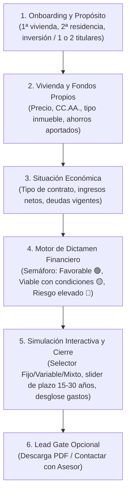

# Especificación UX/UI Validada: Flujo Conversacional y Portal de Maestros (Protocolo HITL)

- **Autor**: `ux_lead` (Líder UX/UI & Product Designer)
- **Estado**: ✅ **Aprobado por el Usuario Humano (HITL Sign-Off)**
- **Fecha de Aprobación**: 2026-10-18

---

## 1. Decisiones Clave Aprobadas por el Usuario (HITL)

1. **Paradigma de Interacción**:
   - **Enfoque Híbrido Adaptativo**:
     - **Desktop/Tablet**: Split-Screen interactivo (Columna izquierda: chat conversacional con micro-inputs; Columna derecha: canvas dinámico en tiempo real con semáforo de viabilidad LTV/DTI, cuota mensual estimada y gráfico de amortización que reacciona a cada dato introducido).
     - **Mobile**: Chat guiado limpio vertical de un solo hilo con inputs fluidos integrados en la conversación y drawer colapsable para consultar el resumen financiero en cualquier momento.
2. **Momento de Captura de Contacto (Lead Gate)**:
   - **Al final sin fricción previa**: La simulación, cálculo de cuota y semáforo de viabilidad son 100% abiertos e interactivos. Los datos de contacto (nombre, email, teléfono) solo se solicitan si el usuario desea:
     - Descargar el informe ejecutivo formal en PDF.
     - Solicitar contacto con un asesor hipotecario.
3. **Alcance del Portal de Maestros y Administración**:
   - **Solo Configuración Paramétrica**: En esta fase se prioriza la gestión estricta de:
     - Políticas de riesgo (umbrales de LTV y DTI).
     - Tipos de interés bancarios (Euríbor oficial, TIN base, diferenciales).
     - Tablas fiscales autonómicas (ITP general/reducido y AJD por CC.AA., más baremos notariales/registrales).

---

## 2. Flujo Conversacional Detallado (5 Fases)

---

## 3. Módulos del Portal de Maestros (Configuración Paramétrica)

1. **Módulo de Políticas de Riesgo**:
   - LTV Máximo primera vivienda (defecto: 80%).
   - LTV Máximo segunda vivienda / inversión (defecto: 70%).
   - DTI Máximo aceptable (defecto: 35%).
   - DTI Alerta / Condicionado (defecto: 40%).
2. **Módulo de Catálogo Financiero**:
   - Valor actual del Euríbor a 12 meses.
   - Tipos de interés de referencia: Fijo base, Diferencial variable, Tramos mixto.
   - Catálogo de bonificaciones estándar (Nómina: -0.20%, Hogar: -0.15%, Vida: -0.15%).
3. **Módulo Fiscal y Aranceles por Comunidad Autónoma**:
   - Tipos de ITP general (ej. Madrid 6%, Cataluña 10%, Andalucía 7%, etc.).
   - Tipos de AJD para obra nueva.
   - Tablas estimativas de aranceles notariales y registrales.
